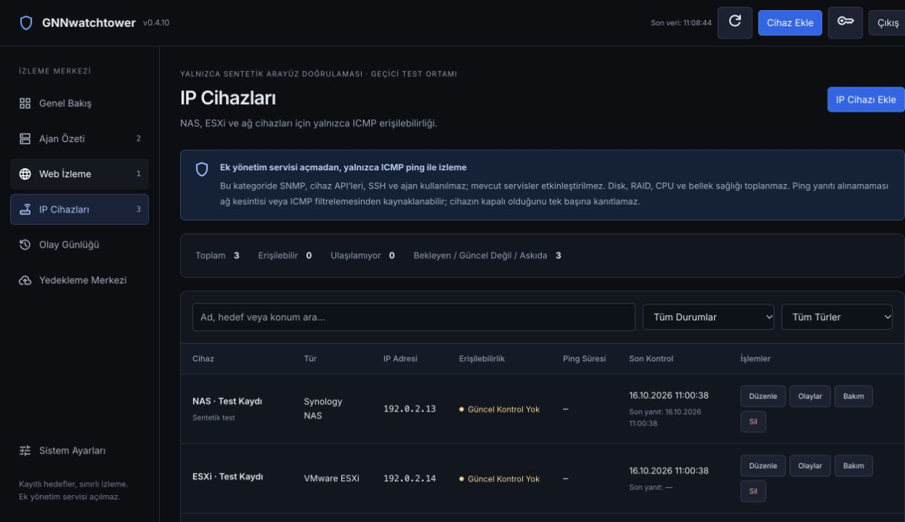

# Monitoring Redesign: Implementation and Validation

Date: 2026-10-16. Scope: operator-approved navigation, manual device entry, ICMP-only appliances, dashboard correction, and complete removal of network discovery. Governing rule: [ADR 0006](../adr/0006-no-additional-attack-surface.md).

## Delivered behavior

- Three disjoint monitoring modes: server, website, icmp. Inventory type remains independent. NAS/ESXi cannot obtain server capabilities through manual entry, update, import, enrollment, heartbeat, service creation, telemetry reads or upgrade dispatch.
- Turkish navigation: the server inventory is labeled Ajan Özeti; agent distribution is available only there. Navigation unmounts the dialog, invalidates pending key requests and clears provisioning material. Windows/Linux tabs distinguish eligible hosts, installed agents and fresh reporting agents.
- Dedicated server, website and IP tables, contextual manual entry, editable validated targets, search, state/type filters, pagination, maintenance/resume, incident navigation and existing backup/settings operations.
- IP devices show only inventory, reachability, measured RTT, check time and relevant actions. Their permanent notice explains ICMP limitations and the absence of disk/RAID collection.
- Dashboard counts reconcile by mode and observation state. The instantaneous reachability ratio includes only fresh online/offline observations; unknown, stale and suspended records are separate. No historical SLA or physical power-health claim is made.
- Existing measured server CPU/RAM/disk utilization, CPU temperature, traffic, historical samples and explicit service controls remain scoped to servers. Agent telemetry becomes stale after 90 seconds, independently of dormant ICMP cadence. Missing values remain unavailable.

## Attack-surface comparison

| Surface | Before | After / evidence |
|---|---|---|
| Discovery | CIDR scanner, UI triggers and POST endpoint | Scanner package/model/modal/client method/route removed; authenticated and anonymous requests to retired route return 404 |
| Per-device reachability | Seven TCP management-port attempts followed by ICMP fallback | One validated OS ICMP request; no TCP fallback, privilege elevation, retry sweep or new helper |
| Appliance dispatch | Poller could execute configured services after checking any device | Mode validation before dispatch; ICMP/website cannot enter server service checks; legacy configuration is retained but ineligible |
| Agent credentials | Manual creation issued tokens for every type | Only server creation issues tokens; appliance reports/enrollment/upgrade requests are rejected before mutations |
| Enrollment | Existing identity could be replaced through broad address/key fallback | Pending server records can enroll using the existing fleet key; enrolled server identities require their own token for refresh; appliance identities are excluded |
| Gateway | Invented default target and duplicate automatic dashboard probes | No invented target; existing configured gateway can be checked explicitly once from dashboard |
| HTTP services | Automatic redirect following | Existing server service checks no longer follow redirects to additional destinations |
| Listeners/dependencies | Existing server, agents, Go/Vue dependencies and deployment privileges | No new application listener, runtime dependency, management credential, customer route or target-side service; existing exposure is not certified safe by this change |

No SNMP, vSphere, Redfish, IPMI, SSH collector, trap receiver or target-side configuration was added. The production installer, running services, firewall and customer networks were not operated during validation. A temporary preview bound only to 127.0.0.1 served synthetic fixtures; it is outside the repository and is stopped after testing.

## Persistence and compatibility

- Additive idempotent migration adds monitoring_mode, last_checked_at, nullable last_probe_latency_ms, probe_error and http_result, plus lookup indexes and mode constraints. Device IDs, agent associations, credentials, telemetry and incident rows are preserved.
- Legacy aliases are classified without probing. Ambiguous/invalid targets are blocked by validation; appliance/unknown agent associations are denied agent capabilities. The migration logs aggregate counts of classifications, invalid targets and blocked legacy associations/services without customer identifiers. Inspect flagged inventory before rollout; no live customer database was opened here.
- Migration never fabricates check timestamps or latency. An old last-success timestamp is not converted into a new observation.
- Actual observations and incident edges commit together. Repeated failures create no duplicate event; recovery closes open records once. Local ICMP execution failures are unknown, rather than confirmed outages. Maintenance/paused profiles skip checks and agent side effects; resume requires a fresh observation.
- Per-target cadence uses last attempted check, retaining the 15-second scheduler baseline and dormant profiles. No immediate retry traffic is added.
- Backup schema 1.1.0 exports monitoring metadata. Schema 1.0.0 and legacy 0.x/unversioned bundles remain subject to current validation; unsupported future versions and duplicate identities/targets are rejected. Imports cannot change an existing target's mode, restore discovery or issue appliance credentials. Failures roll back the transaction.
- Restored new targets begin unknown. Incident history is restored with device-ID remapping and timestamp-normalized duplicate detection. Existing local incidents are preserved. Export retains the existing 1000-incident limit and excludes metric history; the UI states this explicitly.

### Rollout and downgrade

Build artifacts were prepared locally; no release/version bump, commit, push or deployment was performed. Before a deployment, stop the old process and obtain a consistent offline snapshot of its SQLite database including any WAL state, executable and configuration. Review aggregate migration warnings and verify the registered targets under the customer's existing ICMP policy. If ICMP or its local executable is unavailable, accept the unavailable state; do not enable a management service or add privileges to fill missing telemetry.

**Do not run an older executable against the migrated database.** It may ignore monitoring_mode and resume TCP/service probes or agent processing. A rollback requires stopping the new process and restoring the matched pre-upgrade executable and consistent database/configuration snapshot together. A JSON export alone is not a full rollback snapshot because metric history and older incidents are excluded.

## Validation evidence

- PASS: CGO_ENABLED=0 go test -count=1 ./... (all backend packages).
- PASS: go vet ./... with CGO disabled.
- PASS: frontend node:test suite (three category/freshness/data-veracity tests).
- PASS: Vite production build; embedded assets regenerated and obsolete bundles removed.
- PASS: zero-CGO server and agent builds, including Linux amd64 server and agent. Builds use -buildvcs=false because the host's default Git/Xcode integration is unavailable; no source dependency was changed to work around it.
- Focused regressions cover mode/target tampering, appliance credential and service exclusions, authenticated/anonymous retired-route requests, pending-server enrollment and token-protected refresh, actual IP editing, dashboard reconciliation, cadence, suspension, single downtime/recovery events, missing RTT, legacy migration/history preservation, backup round trip/idempotency and unsafe-import rollback.
- Browser review used only disposable synthetic inventory. Verified three lists, IP-only entry fields, NAS filter, correct ESXi incident destination, stale sample labels, no appliance hardware/agent controls, distribution key removal on close/navigation, and readable table scrolling at a narrow viewport without root horizontal overflow.
- No real ping, customer scan, customer agent upgrade or outgoing alert was performed for validation. Collector calls and alert delivery were substituted in focused tests. This does not claim testing every localized OS ping output or physical appliance compatibility.

The image is a test fixture view, not customer telemetry. Its stale records deliberately demonstrate that old observations are not shown as current health.

## Limits and existing debt

This is an implementation-focused regression and exposure review, not a fresh certification of all previous audit findings. Existing bootstrap-password behavior, deployment/root capabilities, exposed application endpoints, update/provisioning trust and comprehensive HTTP egress/SSRF hardening remain separate security work. No claim that those findings are closed, or that the application has zero risk, is made.
