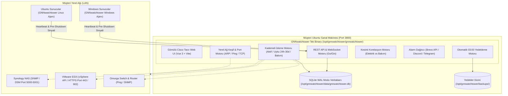

# GNNwatchtower - Uygulama ve Mimari Planı (IMPLEMENTATION_PLAN.md)

Bu belge, **GNNwatchtower** altyapı, ağ ve sunucu izleme sisteminin tüm teknik mimarisini, veri modelini, kullanıcı arayüzü tasarımını ve kurulum adımlarını içeren ana planlama dokümanıdır.

---

## 1. Proje Özeti ve Dağıtım Hedefi

* **Hedef Sistem**: 20 GB Disk ve 4 GB RAM içeren bağımsız Ubuntu Sanal Makinesi (VM).
* **Dağıtım Kapsamı**: MSP (Managed Service Provider) modeli. Her müşterinin kendi yerel ağında bağımsız bir sanal cihaz (appliance) olarak çalışacak.
* **Servis Portu**: `3800` (Yerel ağdaki hiçbir standart servis veya web sunucusuyla çakışmayan izole port).
* **Temel Mimari İlkesi**: Tek bir ikili dosya (Single Binary), harici Nginx veya Docker zorunluluğu olmayan yerel Systemd servisi, Pure Go SQLite (WAL modu) ve sıfır harici C bağımlılığı.

---

## 2. Sistem Mimarisi ve Teknoloji Yığını



### Temel Bileşenler
1. **Backend & Core (Go 1.22)**:
   - Bellek tüketimi: ~25-35 MB RAM.
   - Go'nun `embed` yeteneği ile Vue 3 statik dosyaları doğrudan tek bir ikili dosya içine gömülür.
   - Harici web sunucusu (Nginx/Apache) veya runtime (Node.js/Python) gerekmez.

2. **Veritabanı (Pure Go SQLite - WAL Modu)**:
   - CGO gerektirmeyen saf Go sürücüsü (`modernc.org/sqlite`).
   - Write-Ahead Logging (WAL) modu: Yüksek eşzamanlılık, sıfır kilitlenme.
   - Veritabanı tek bir dosyadır (`gnnwatchtower.db`). Yedekleme veya taşıma bu dosyanın kopyalanması kadar basittir.

3. **Frontend (Vue 3 + Tailwind CSS + Google Fonts + Google Material Symbols)**:
   - Minimalist Cisco Meraki / Enterprise konsol stili.
   - Tipografi: Tablo sayılarında ve IP adreslerinde sabit genişlikli (tabular monospace) Google **Inter** yazı tipi.
   - İkonografi: Google **Material Symbols (Outlined)**. Sistem emojileri kesinlikle kullanılmaz.

---

## 3. Cisco Tarzı Minimalist Tasarım Dili (UI/UX)

* **Renk Düzeni**:
  - Arka Plan: Koyu Lacivert ve Arduvaz tonları (`#0b132b`, `#1c2541`, `#0f172a`).
  - Vurgu Rengi: Cisco Mavisi (`#00bceb` / `#0284c7`).
  - Kart ve Tablo Çerçeveleri: İnce yüksek kontrastlı bordürler (`border-slate-800`).
* **Durum LED Göstergeleri**:
  - Çevrimiçi (Online): Zümrüt Yeşili LED (`#10b981`) + hafif parlama efekti.
  - Çevrimdışı (Offline): Gül Kırmızısı LED (`#f43f5e`).
  - Uyarı / Bakım (Warning/Maintenance): Kehribar Sarısı LED (`#f59e0b`).
  - Uyku / Pasif (Dormant): Çelik Grisi (`#64748b`).
* **Navigasyon ve Yerleşim**:
  - **Sol Menü (Sidebar)**: Daraltılabilir minimalist çubuk (Genel Bakış, Cihazlar, Ağ Keşfi, Kesintiler & SLA, Yedekleme, Ayarlar).
  - **Üst Çubuk (Top Bar)**: Müşteri Şirket Adı, Lokasyon Bilgisi, Sistem Sağlık Skoru (Uptime %), Canlı Saat.
  - **Veri Izgarası (Dense Data Grid)**: IP/MAC adresleri, yanıt süreleri, profil etiketleri ve tek tıkla işlem butonları.

---

## 4. Temel Fonksiyonel Modüller

### 4.1. Otomatik Ağ Keşfi (Auto-Discovery Engine)
* **Taramalar**: Operatörün belirlediği CIDR bloğunu (örn. `192.168.1.0/24`) 64 eşzamanlı iş parçacığıyla (goroutine) 5 saniyede tarar.
* **Güvenlik Sınırı (SSRF Koruması)**: CIDR girişi `net.ParseCIDR` ile sıkı doğrulanır; varsayılan olarak yalnızca RFC 1918 özel IP bloklarına (`10.0.0.0/8`, `172.16.0.0/12`, `192.168.0.0/16`) izin verilir. Harici genel IP taramaları admin onayı olmadan engellenir.
* **Cihaz Tanıma Kuralları**:
  - Port `5000` / `5001` açık -> Synology NAS
  - Port `902` veya `443` (vSphere) açık -> VMware ESXi
  - Port `3389` açık -> Windows Server
  - Port `22` açık -> Ubuntu / Linux Sunucu
  - Port `161` (SNMP) açık -> Switch / Router
* **Hızlı İçe Aktarma**: Keşfedilen cihazlar tek tek veya "Tümünü Ekle" butonu ile sisteme eklenir.

### 4.2. Kademeli İzleme ve Uyku Profilleri (Smart Polling Profiles)
Gereksiz ping kirliliği ve log şişmesini önlemek için her cihaza profil atanabilir:
1. **Aktif Profil (Active)**: 15 saniyede bir ping ve servis port kontrolü.
2. **24 Saatlik Uyku (Dormant 24h)**: Günde bir kez kontrol edilir (Soğuk yedek sunucular için).
3. **30 Günlük Uyku (Dormant 30d)**: Ayda bir kez kontrol edilir (Arşiv ve dönemsel sunucular için).
4. **Bakım Modu (Maintenance)**: Operatör süreli bakım başlatır; bu sürede alarm üretilmez ve SLA oranından düşülmez.

### 4.3. Akıllı Kesinti Tespiti (Elektrik Kesintisi vs Bakım)
1. **Pre-Shutdown Sinyali (Temiz Kapanma)**:
   - Sunucudaki mini-ajan, Windows'un veya Linux'un kapanma sinyalini yakaladığında merkeze paket atar: `"reason": "user_restart" | "os_update"`. Sistem bunu anında **Planlı Bakım** olarak işaretler.
2. **Toplu Kesinti Korelasyonu**:
   - Aynı anda 3 veya daha fazla cihazın bağlantısı aniden kesilirse, sistem bunu **Elektrik Kesintisi veya Ana Switch Arızası** olarak işaretler.
3. **Operatör Doğrulama Formu (Post-Mortem Modal)**:
   - Cihaz açıldığında operatöre tek tıkla doğrulatır:
     - [ ] Şebeke / Elektrik Kesintisi
     - [ ] Planlı Bakım / Çalışma
     - [ ] Sistem / Donanım Çökmesi
     - [ ] Ağ / Kablo Problemi
   - Operatörün girdiği notlar ay sonu müşteri raporuna girer.

### 4.4. Bildirim Motoru (Brevo, Discord, Telegram)
* **Brevo (Sendinblue) Entegrasyonu**:
  - Doğrudan **Brevo REST API (`https://api.brevo.com/v3/smtp/email`)** üzerinden HTTPS (Port 443) ile gönderim. Port 25/587 kısıtlamalarından etkilenmez.
  - Ayarlar: API Anahtarı, Gönderici E-posta, Gönderici Adı, Alıcı E-posta.
* **Discord Webhook Entegrasyonu**: Belirtilen kanala anlık bildirim fırlatma.
* **Telegram Bot Entegrasyonu**: Bot Token ve Chat ID ile bildirim iletme.
* **Alarm Sönümleme & Taşırma Koruması (Anti-Flapping & Cooldown)**:
  - Sürekli kesilip gelen (flapping) cihazlar için bildirimlere 3 dakikalık bekleme süresi (cooldown) uygulanır.
  - Dış API çağrılarında (Brevo/Telegram/Discord) HTTP 429 yanıtlarına karşı üstel geri çekilme (exponential backoff) zorunludur.

### 4.5. Tek Tuşla Mini-Ajan Dağıtımı (Zero-Touch Agent)
Paneldeki "Ajan Kur" butonuna basıldığında ekrana tek satırlık hazır komut gelir:
* **Ubuntu / Debian**:
  ```bash
  curl -sSL http://SERVER_IP:3800/api/agent/install/linux?otp=TEMP_NONCE | sudo bash
  ```
* **Windows Server**:
  ```powershell
  powershell -ExecutionPolicy Bypass -Command "irm http://SERVER_IP:3800/api/agent/install/windows?otp=TEMP_NONCE | iex"
  ```
* **Token Güvenliği (OTP / Nonce İlkesi)**: Kurulum URL'sindeki `otp` parametresi kalıcı token değil, 15 dakika geçerli tek kullanımlık bir yetkilendirme anahtarıdır. Ajan kurulurken merkeze güvenli kayıt yapar ve sunucudan 48 baytlık kalıcı `agent_token` alır. Böylece URL'lerin proxy veya komut geçmişinde sızması önlenir.

### 4.6. Basit Yedekleme ve Taşıma (Backup & Portability)
1. **Manuel Web Yedekleme**: Yalnızca doğrulanmış admin oturumu ile paneldeki "Yedek Al" butonuna basıldığında ayarları ve cihazları içeren SHA-256 imzalı `gnnwatchtower-backup-TARIH.json` dosyası indirilir.
2. **Manuel Geri Yükleme**: Sıfır kurulan sisteme bu dosya yüklendiğinde şema ve imza kontrolünden geçerek 5 saniyede geri yüklenir.
3. **Otomatik Yerel Yedekleme**: Her gece 03:00'te `/opt/gnnwatchtower/backups/` altına tarihli yedek alınır; 30 günden eski dosyalar otomatik temizlenir.

---

## 5. Kurulum Betiği (Turnkey Installer)

Müşteri Ubuntu sanal makinesinde çalıştırılacak tek komut:
```bash
sudo bash install.sh
```
Betiğin otomatik yapacağı işlemler:
1. İkili dosyayı `/opt/gnnwatchtower/gnnwatchtower` dizinine yerleştirir.
2. Dizinleri ve izinleri ayarlar (`/opt/gnnwatchtower/data`, `/opt/gnnwatchtower/backups`).
3. `/etc/systemd/system/gnnwatchtower.service` dosyasını oluşturur ve servisi başlatır.
4. UFW üzerinden `3800` portunu açar.
5. Ekrana erişim adresini basar: `http://SUNUCU_IP:3800` (Geçici ilk giriş: `admin` / `admin`).
6. **Zorunlu İlk Şifre Değişimi**: İlk girişte operatör şifresini değiştirmeden sistem kontrol paneline erişime izin verilmez.

---

## 6. Geliştirme Yol Haritası ve Fazlar

| Aşama | Başlık | Durum |
|---|---|---|
| **Faz 1** | Veritabanı & Çekirdek API (SQLite WAL, Auth, Settings) | Tamamlandı |
| **Faz 2** | Ağ Keşif & Alarm Motoru (Brevo REST API, Discord, Telegram, Korelasyon) | Tamamlandı |
| **Faz 3** | Mini-Ajan (Windows & Linux için Pre-Shutdown sinyali ve servis yönetimi) | Beklemede (Onay Sonrası) |
| **Faz 4** | Cisco Tarzı Minimalist Web UI (Vue 3, Inter Font, Google Icons) | Beklemede (Onay Sonrası) |
| **Faz 5** | Dağıtım & Paketleme (Go embed, `install.sh`, systemd unit) | Beklemede (Onay Sonrası) |

---

## 7. Güvenlik ve Mimari Denetim Notları (Audit Notes)

Bu bölüm, `sentinel-planaudit` denetimi kapsamında projeye eklenen zorunlu mimari ve güvenlik kurallarını içerir:

1. **Public Repository Sıfır Sızıntı Sözleşmesi (ADR-0003)**:
   - Proje açık kaynaklı ve herkese açık GitHub deposundadır (`https://github.com/BigDesigner/project-gnnwatchtower.git`).
   - Müşteri IP blokları, cihaz MAC adresleri, keşif veritabanı (`data/gnnwatchtower.db`), gece yedekleri (`backups/`) ve `.env` dosyası Git'e asla eklenemez.
2. **SSRF ve Yerel Ağ Sınır Kontrolü (.specs/boundary-conditions.md)**:
   - CIDR tarayıcısı yalnızca RFC 1918 özel ağlarını (`10.0.0.0/8`, `172.16.0.0/12`, `192.168.0.0/16`) tarayacak şekilde sınırlandırılmıştır.
3. **Tek Kullanımlık Ajan Kurulum Anahtarları (OTP Nonce)**:
   - Ajan dağıtım linklerindeki token sızıntısını önlemek için URL üzerinden kalıcı token dağıtımı yasaklanmış, 15 dakikalık tek kullanımlık nonce (OTP) mekanizması zorunlu tutulmuştur.
4. **Alarm Debouncing ve Egress Koruması (.specs/boundary-conditions.md)**:
   - Flapping durumlarında bildirim bombardımanını engellemek için 3 dakikalık alarm sönümleme ve harici API'ler için HTTP 429 üstel geri çekilme (exponential backoff) kuralı plana işlenmiştir.
5. **Varsayılan Kimlik Bilgisi Güvenliği**:
   - `admin / admin` varsayılan şifresiyle çalışan sistemlerin sahada zafiyet yaratmaması için ilk girişte zorunlu şifre değişimi (force password update) kuralı getirilmiştir.
6. **Cisco Meraki Dark UI & Sıfır Emoji Kuralı (.specs/constitution.md)**:
   - Dashboard ve sistem kayıtlarında dekoratif emojiler yasaklanmış, durumlar CSS LED göstergeleri ve Google Material Symbols ile ifade edilecek şekilde kurala bağlanmıştır.

